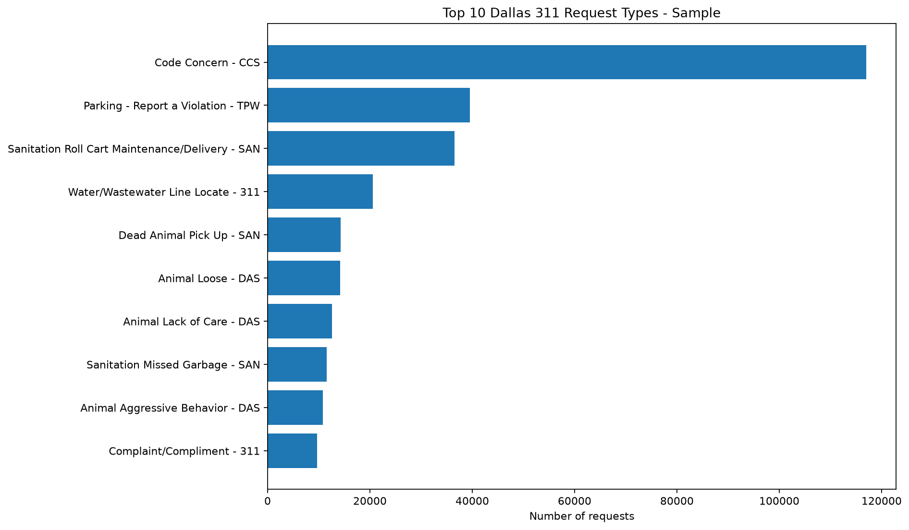
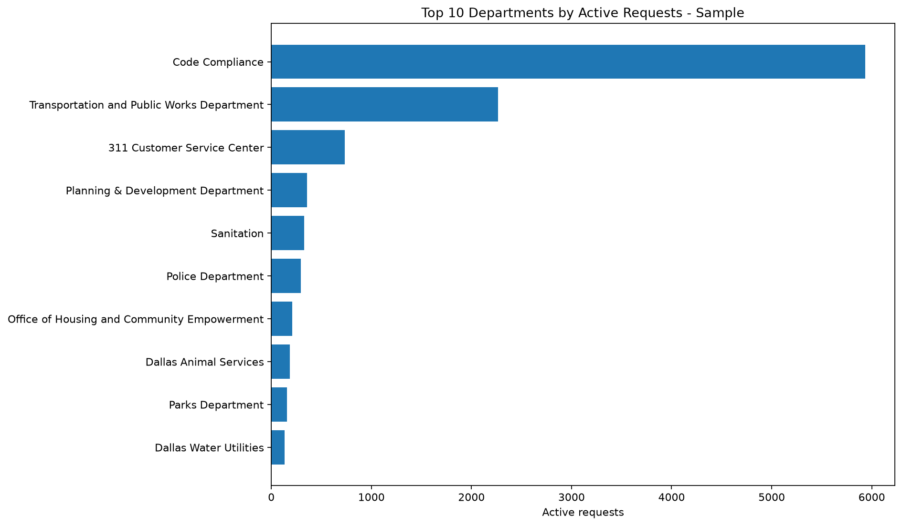

# Dallas 311 Analytics Pipeline

An end-to-end Python and SQL analytics project analyzing 426,196 Dallas 311 service requests collected from the City of Dallas Open Data portal.

## Project Overview

This project demonstrates how public service request data can be collected, stored, validated, analyzed, and visualized using a repeatable data pipeline.

The goal is to identify patterns in service demand, request closure rates, and turnaround times across different categories and city departments.

## Technologies

- Python — data collection, processing, and reporting
- SQL — querying and analyzing service requests
- SQLite — local database storage
- Matplotlib — data visualization
- Git and GitHub — version control

## Dataset

**Source:** City of Dallas Open Data — 311 Service Requests

**Records analyzed:** 426,196

**Date range:** November 22, 2025 – November 21, 2026

The dataset includes service request categories, responsible departments, statuses, and timestamps.

## Pipeline Features

- Retrieves records from the Dallas Open Data API
- Processes API responses in batches
- Validates incoming records and prevents duplicate request IDs
- Stores structured records in SQLite
- Supports resuming historical downloads
- Generates CSV reports and PNG visualizations
- Includes automated Python tests

## Selected Findings

### Most Common Request Categories

| Request Type | Total Requests |
|---|---:|
| Code Concern | 116,974 |
| Parking Violations | 39,514 |
| Sanitation Roll Cart Maintenance/Delivery | 36,523 |
| Water/Wastewater Line Locate | 20,521 |
| Dead Animal Pickup | 14,265 |

### Turnaround Analysis

Selected findings from closed requests:

- Traffic Speed Control: 56.7 average days to close
- Traffic Sign — New: 47.5 average days
- Alley Repair — Routine: 39.2 average days
- Street Repair — Routine: 25.8 average days
- Code Concern: 11.4 average days

These are descriptive results, not adjusted comparisons of departmental performance. Request complexity, reporting practices, and the observation window can affect the results.

## Visualizations

The project generates charts showing:

- Top 10 service request categories
- Top 10 departments by active requests

Charts are saved in the `reports/` directory.

## Running the Project

Create a Python environment and install the charting dependency:

```bash
python3 -m venv .venv
source .venv/bin/activate
python3 -m pip install matplotlib
```

Run a bounded sample and generate reports:

```bash
python3 pipeline.py --days 30 --max-records 5000 --db dallas311.sqlite
python3 generate_department_report.py
python3 charts.py
```

Run the tests:

```bash
python3 -m unittest discover -s tests
```

The historical backfill script, `resume_history.py`, supports continuing an existing historical download.

## Limitations

- Results reflect a historical snapshot, not live operational performance.
- Closed requests do not necessarily indicate successful resolution.
- Differences in request types and complexity can affect turnaround comparisons.
- The project does not publish row-level personal information or precise locations.

## Project Purpose

Built as a data analytics portfolio project to demonstrate practical experience with Python, SQL, data pipelines, data quality, and reporting.

## Visualizations

### Most Common Service Requests


### Active Requests by Department


